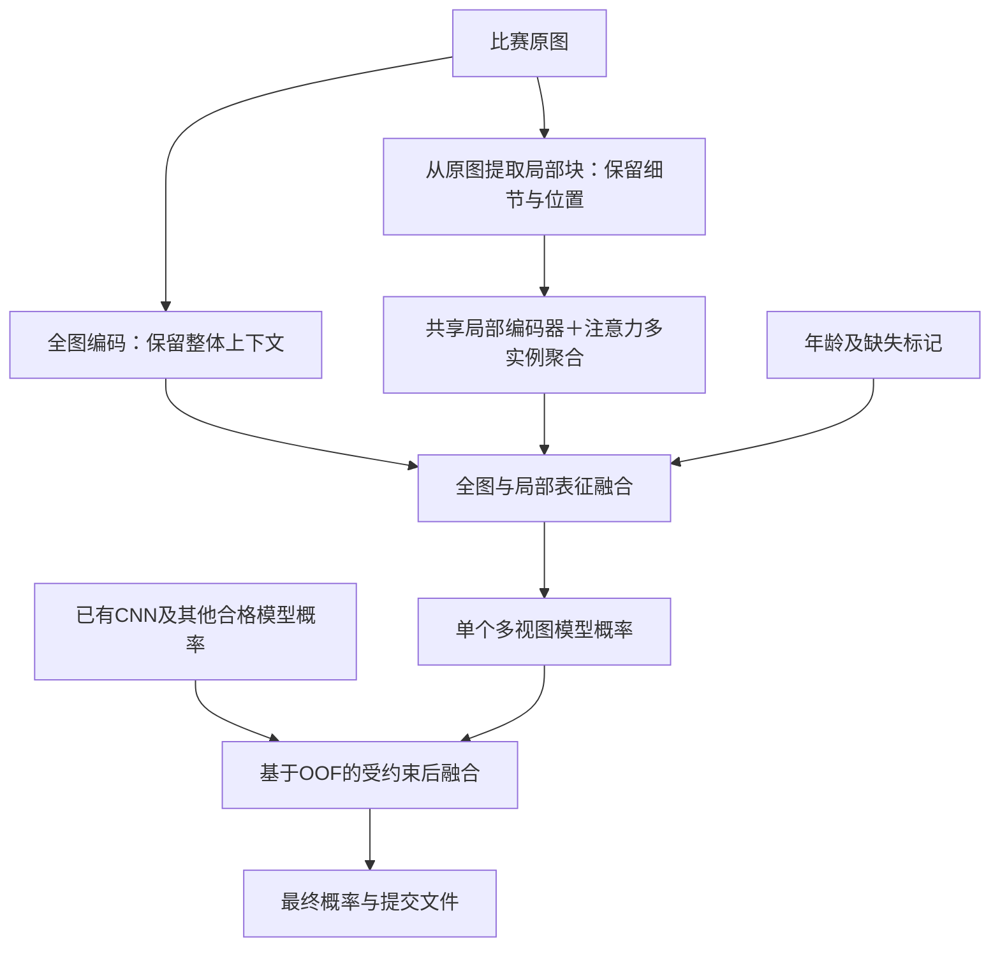

# 全图—局部多尺度表征与互补集成开发计划书

日期：2026-10-18。状态：待择机执行。

## 一、目标与路线结论

以初赛 AUROC 上限为首要目标，AUPRC 为辅助判断；本阶段允许多模型方案，复赛的模型体积和推理时延在后续交付阶段处理。

推荐主路线：**强预训练视觉表征的任务适配 → 全图与原图局部多尺度学习 → 年龄信息融合 → 有验证收益的异构集成。**

最主要的增益假设是：保留整图缩放时容易损失的局部细节，并利用不同表征的错排互补。RFM／DINOv3 是优先研究的基础模型候选，CNN 是同等重要的参照及潜在互补成员；最终主干和成员由实际贡献决定。

本计划只确定主要技术路线、开发顺序和验收方式。输入尺寸、局部块数量、学习率、训练轮数、增强参数及执行加速在实施各阶段时另行制定，不在这里展开。

### 已确认的边界

- 使用比赛现有图像、二分类标签和年龄；沿用已允许的预训练权重，不新增外部训练数据。**该限制来自主办方赛规，不是项目自设**：赛题说明「4.其他约束」写明“本次比赛只允许参赛选手使用主办方提供的训练数据集”“允许使用数据增强技术，但不允许使用外部标注数据”。如需变更，只能以主办方后续通知或答疑为准，不得由项目自行放宽。
- 先使用已有标注；少量训练图片的定位或结构补标注作为条件升级。
- 使用现有两台电脑，不增加付费资源；每阶段有界执行，不自动跨天重启。
- 原有 RFM 累计预算账本继续有效，不自动重置或通过更名绕过；预算耗尽时暂停该分支。
- 本文不授权启动训练、下载新权重、评测官方 valid/test 或上传比赛结果。

## 二、起点与理论依据

### 当前起点

| 已有路线 | 真实证据 | 在新路线中的用途 |
|---|---|---|
| Green 末两层微调＋年龄 | 完整三折 OOF：AUROC 0.954204、AUPRC 0.596208，51,396 张 | 可立即使用的完整基线及融合候选 |
| RFM 冻结＋年龄 | 完整三折 OOF：AUROC 0.944772、AUPRC 0.548398 | 支持继续研究其任务适配，尚不代表微调上限 |
| 同事 CNN | 用户报告初步 AUROC 0.98+；实际配置、完整结果尚未回传 | 后续形成强对照；回传后更新基线，不阻塞本路线设计 |

Green 完整结果见 [队列状态](artifacts/green_cv/state.json) 和 [OOF 记录](artifacts/green_ft2/oof.json)。旧状态文档可能滞后，执行前以产物复核为准。

### 为什么优先研究这条路线

1. **信息保留。** 全图提供上下文，从原图提取局部块保留缩放容易损失的细节。局部分支改善的是信息可用性；该设计同样适用于 CNN。[全图与视盘局部结合的研究](https://arxiv.org/abs/1805.07549)
2. **视野互补。** 局部视盘值得重点关注，全图也应保留，因为判别信息可能分布在视盘外。[视盘外信息研究](https://arxiv.org/abs/2103.11895)
3. **表征互补。** 自监督与眼底预训练可能提供不同于现有 ImageNet CNN 的结构特征。DINOv3 的密集特征为局部建模提供了候选表征；通用视觉结果不直接等于本比赛优势。[DINOv3 原始研究](https://arxiv.org/abs/2508.10104)
4. **标签适配。** 注意力多实例学习允许用整图标签聚合局部块，适合缺少局部标注的起点。[Attention-based Deep Multiple Instance Learning](https://proceedings.mlr.press/v80/ilse18a.html)

年龄已存在于原有模型中，因此年龄融合不是本轮新增优势。基础模型是否优于 CNN，以及多视图是否有效，分别验证，不混为同一结论。

## 三、目标系统

### 1. 全图表征

- 首先研究 **RFM 的监督任务适配**，复用本地权重与已有对照；随后按阶段结果决定是否研究 **DINOv3 ViT-B** 的通用预训练起点。
- 两者属于相关的表征谱系，定位为主干候选比较，不默认视为两个天然互补的集成成员。
- 保留 Green 完整结果及现有 CNN。开发重点从冻结特征的小分类头扩展到任务适配的图像表征。

### 2. 全图—局部分支

- 从原图读取局部区域，避免先把整图缩小后再放大裁块。
- 第一版采用有覆盖性的多尺度局部取样；视盘先验用于引导候选区域，不以不可靠的单点定位决定全部输入。
- 局部块共享编码器，保留位置与有效性信息，通过注意力 MIL 聚合为图像级表征。
- 阳性整图中的每个局部块不一定含阳性证据；只使用图像级监督，不把整图标签逐块当作真实局部标签。
- 保留独立的全图预测路径；局部提取失败或局部块不可用时可退回全图路径。

### 3. 年龄与模型间融合

- 年龄作为辅助条件与视觉表征融合，沿用训练折内拟合的处理规则。
- 先形成可单独使用的多视图模型，再评估模型间后融合；后融合保留退化为最佳单模型的选择。
- 成员依据独立能力及对强模型错排的修正价值筛选；不因为模型数量多或名称不同就全部纳入。
- 优先复用同事实际优胜 CNN。只有当前成员的互补性不足时，再考虑新增 ConvNeXt V2 等结构不同的主干。

## 四、分阶段开发与决策闸门

各阶段均先完成实现检查和开发比较，再决定是否投入完整验证。已完成且配置、数据身份匹配的实验直接复用。

| 阶段 | 开发任务 | 必须交付 | 继续或停止条件 |
|---|---|---|---|
| P0：建立比较起点 | 固定数据与划分，归档当前 Green；CNN 回传后校验并纳入 | 基线清单、配置及来源、已有 OOF、当前最强可核验结果 | 有效基线即可开展后续开发，不等待所有同事实验结束 |
| P1：全图表征适配 | 研究 RFM 全图任务适配；需要时增加 DINOv3 对照 | 可独立使用的全图模型、内部预测、相对基线的判断 | 单模型有竞争力或显示明确互补价值则保留；表现弱且无互补价值则降级 |
| P2：多尺度局部建模 | 实现原图局部取样、共享编码与注意力 MIL，加入全图分支 | 可运行的多视图模型、局部区域可视化、失败回退记录、单视图对照 | 局部信息带来可复现的净收益才进入候选；不因框架已实现就强行采用 |
| P3：归因与正式验证 | 在统一划分下比较主干与视图因素；优胜配置形成完整 OOF | 对照矩阵、完整 OOF、分折结果、增益归因 | 区分主干收益与多视图收益；若 CNN 多视图更优，允许直接成为主力 |
| P4：互补集成 | 从合格成员中选择组合，评价对最强单模型的增量价值 | 单模型及组合对比、成员清单、融合定义、候选方案 | 组合经独立确认有收益则采用，否则交付最佳单模型 |
| P5：初赛候选交付 | 固定最终方案，完成全 train 重训及推理、提交格式核验 | 模型、实际配置、训练记录、提交 CSV、使用说明 | 预定官方验证里程碑确认后，由用户决定正式提交 |

### 最小归因矩阵

| 比较项 | 全图＋年龄 | 全图＋原图局部＋年龄 |
|---|---|---|
| 现有强 CNN | 已有或回传的基线 | 检验多视图对 CNN 的价值 |
| 选定基础模型 | 检验表征适配的价值 | 检验基础模型与多视图结合的价值 |

矩阵按阶段补齐，不一开始铺开所有模型。若增益主要来自多视图而非基础模型，就围绕更强的 CNN 多视图继续开发；这同样实现本计划的信息利用目标。

## 五、验证、工程交付与分工

### 验证约定

- 沿用统一三折及相似图片分组；未取得患者身份时，如实标注患者独立性尚未确认。
- 主干、视图、年龄等因素尽量单独比较；不把“完整微调 CNN”与“冻结基础模型”的差距直接归因于架构。
- 年龄变换、学习到的区域选择器、额外自监督适配和融合训练，都遵守对应训练折边界。外层留出折只用于评估，不拟合这些组件。
- 开发折用于筛方向；正式结论需要完整 OOF、分折稳定性及对当前最强基线的比较。小于 0.002 的 AUROC 优势沿用第二种子复验要求。
- OOF 同时用于模型或融合选择时，分数标记为开发估计；融合增益需要训练数据内嵌套评估或预留的独立确认。官方 valid 继续按约定里程碑使用，test 不参与拟合和选型。
- 工程检查覆盖局部块与样本对齐、图像级监督、有效块掩码、空局部回退、检查点重载及提交顺序。已有单图模型和检查点继续可用。

### 工程交付

复用现有 `glaucoma`、`configs`、`scripts`、`tests` 目录。扩展模型与数据表示以支持全图、局部块集合、有效性信息及年龄；训练、OOF 汇总、预测和交付保持统一入口。避免为新路线另建独立训练框架。

每个候选保留：实际配置、预训练来源与校验值、数据和划分身份、训练历史、检查点、逐样本预测、指标、耗时及适用限制。实验产物继续放在 `artifacts/`，原始数据保持只读。

### 双机建议分工

- **主机**：负责基础模型适配、全图—局部原型、统一验证及最终融合。
- **同事电脑**：完成并交回当前 CNN 证据；收到统一的局部表示与验证约定后，承担 CNN 多视图对照。
- 同事实际进度和可用性在执行时确认；主机不重复已完成的匹配实验，两机不并行消耗同一本 RFM 预算账本。

## 六、条件升级与执行顺序

| 条件 | 升级方向 | 决策依据 |
|---|---|---|
| 弱监督局部选择不稳定，错误集中在视盘或周围结构 | 从比赛 train 中补少量定位标注，增加显式定位；结构标注具备可靠性时再考虑分割辅助学习 | 定位或结构信息确实改善错误，不以可视化更漂亮作为成功标准 |
| 已有强预训练仍表现出明显的目标域不适配 | 在对应训练折图片上继续自监督适配，再接监督任务 | 收益须超过直接任务适配，计入额外开发与计算成本 |
| 不同主干在强模型错排处显示互补潜力 | 增加少量结构不同的候选，形成受控异构集成 | 以实际融合增益决定成员，避免无目的扩大模型清单 |

**建议执行顺序：P0 → P1 → P2 → P3 → P4 → P5。** 在 P1、P2 出现明确失败信号时及时调整或停止该分支，保留当前最强单模型作为可交付底座。

本阶段成功的标志是得到一套在统一评价口径下优于当前最强可核验基线的候选方案，并明确收益来自何处。若新增分支均无收益，交付保留原强模型的结论与证据；不预写目标分数。复赛压缩、蒸馏和时延适配另立后续计划。
